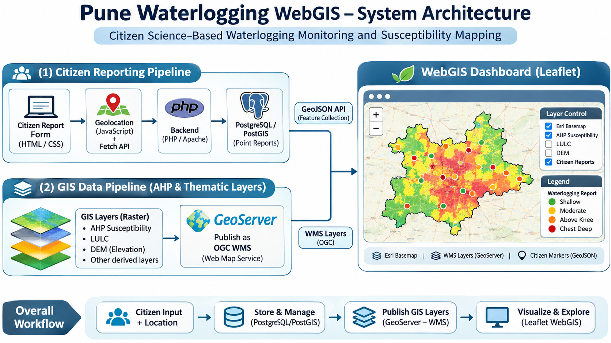

# Pune Waterlogging WebGIS

**Citizen Science-Based Waterlogging Monitoring and Susceptibility Mapping**

A WebGIS application developed to support waterlogging monitoring in Pune, Maharashtra, India. The project combines GIS-based waterlogging susceptibility layers with geotagged citizen reports through an interactive web dashboard.

## Project Objectives

- Visualize waterlogging susceptibility using AHP-based GIS analysis.
- Enable citizens to submit location-based waterlogging reports.
- Store citizen reports as spatial point data.
- Integrate susceptibility maps and reported waterlogging locations in a WebGIS dashboard.
- Display thematic GIS layers such as LULC and DEM.

## Technologies Used

| Component | Technology |
|---|---|
| Frontend | HTML, CSS, JavaScript |
| Interactive mapping | Leaflet.js |
| Backend | PHP, Apache |
| Database | PostgreSQL, PostGIS |
| GIS map server | GeoServer |
| Spatial data services | OGC WMS, GeoJSON |
| GIS analysis | AHP, raster-based spatial analysis |
| Development environment | VS Code, XAMPP |

## System Architecture


The application contains two main data pipelines.

### 1. Citizen Reporting Pipeline

Citizen Report Form → Browser Geolocation → JavaScript Fetch API → PHP Backend → PostgreSQL/PostGIS → GeoJSON API → Leaflet Citizen Markers

### 2. GIS Data Pipeline

AHP Susceptibility, LULC and DEM Raster Layers → GeoServer → OGC WMS → Leaflet WebGIS Dashboard

The dashboard integrates these two pipelines with a basemap, thematic layer controls, citizen report markers and map legends.

## Project Structure

```text
Pune-Waterlogging-WebGIS/
├── css/
│   └── style.css
├── js/
│   ├── app.js
│   └── map.js
├── php/
│   ├── db_connect.php
│   ├── submit_report.php
│   └── get_reports.php
├── screenshot/
├── index.html
├── dashboard.html
└── README.md
```

## Application Features

- Citizen waterlogging reporting form
- Browser-based GPS location capture
- Water depth and suspected cause reporting
- Photo upload field
- Spatial data storage using PostGIS
- Interactive Leaflet map
- AHP susceptibility, LULC and DEM map layers served through GeoServer
- GeoJSON citizen report visualization
- Layer controls and map legends

## Screenshots

Add screenshots of the citizen reporting form and WebGIS dashboard to the `screenshot/` folder.

## Local Setup

### Prerequisites

- Apache and PHP (for example, through XAMPP)
- PostgreSQL with PostGIS
- GeoServer
- A modern web browser

### Steps

1. Clone this repository.
2. Place the project folder inside the Apache web root, such as `C:/xampp/htdocs/`.
3. Create and configure the PostgreSQL/PostGIS database and required spatial table.
4. Configure the PHP database connection using local environment variables or a secure, untracked configuration file.
5. Start Apache, PostgreSQL and GeoServer.
6. Publish the required GIS layers in GeoServer and configure the corresponding WMS layer names in `js/map.js`.
7. Open the application through the local Apache server.

Citizen reporting page:

`http://localhost/Pune-Waterlogging-WebGIS/index.html`

WebGIS dashboard:

`http://localhost/Pune-Waterlogging-WebGIS/dashboard.html`

**Note:** This repository does not yet provide a complete automated database and GeoServer setup. Database schema, local paths and service configuration must match the deployment environment.

## Future Enhancements

- Improve citizen report validation and moderation.
- Add administrative report management.
- Enhance spatial and temporal analysis of waterlogging reports.
- Deploy the application to a secure public hosting environment.

## Project Status

Development and local testing.

## Author

[Aditya Singh](https://github.com/codes-aditya)